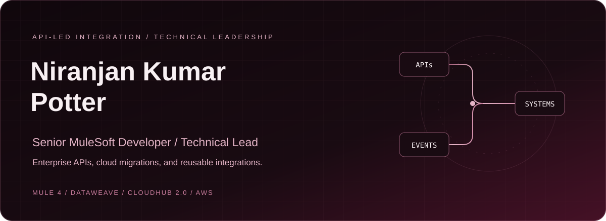

## Hi there 👋

  

  <a href="https://www.linkedin.com/in/niranjan-potter-551b49171">LinkedIn</a>
  &nbsp; / &nbsp;
  <a href="https://www.salesforce.com/trailblazer/npotter3">Trailblazer</a>
  &nbsp; / &nbsp;
  <a href="https://github.com/niranjanpotter?tab=repositories">Repositories</a>

# Hi, I'm Niranjan

I build enterprise integrations with MuleSoft. My work covers API design, DataWeave transformations,
CloudHub migrations, and production support. I also lead technical reviews and mentor integration developers.

I've worked in integration engineering since 2021, connecting enterprise applications across energy and
utilities, employee data workflows, and order processing.

## What I work on

- Design and implement API-led integrations using Mule 4, RAML, APIkit, and Anypoint Platform.
- Migrate applications from CloudHub 1.0 to CloudHub 2.0 and upgrade Mule runtimes to Java 17.
- Build reusable logging, error-handling, and database components.
- Connect AWS services to Mule flows and automate delivery with Azure DevOps, Maven, and MUnit.
- Explore agent orchestration with Model Context Protocol (MCP) and MuleSoft Agent Fabric.

## Selected integration work

These are summaries of professional work. Client code and internal implementation details are not published here.

| Area | My contribution | Technologies |
| :--- | :--- | :--- |
| Enterprise API delivery | Built reusable integration components and asynchronous flows; led technical reviews and developer mentoring. | Mule 4, DataWeave, Anypoint MQ |
| Cloud modernization | Migrated APIs to CloudHub 2.0 and upgraded applications from Java 8 to Java 17. | CloudHub 2.0, Java 17, Azure Pipelines |
| Employee data integration | Built scheduled flows connecting HR data with CRM and other enterprise applications. | Workday, Salesforce, HTTP, SQL |
| Order integration | Supported CRM-to-ERP order flows and investigated scheduler failures and data discrepancies. | MuleSoft, CRM/ERP integration, production support |
| Delivery automation | Automated builds and deployments with integration tests and code-quality checks. | Maven, Azure DevOps, MUnit, SonarQube |

## Technical toolkit

| Category | Technologies |
| :--- | :--- |
| Integration | Mule 4, Anypoint Platform, CloudHub 2.0, Anypoint MQ, API Manager, APIkit |
| API design and data | REST, SOAP, RAML, DataWeave 2.0, JSON, XML, GraphQL |
| Languages and databases | Java 17, SQL, MySQL, SQL Server, Oracle, PostgreSQL |
| AWS | S3, DynamoDB, Secrets Manager |
| Delivery and testing | Azure DevOps, Maven, Git, Jenkins, MUnit, SonarQube, Postman |
| Operations and tooling | Splunk, Jira, Confluence, Anypoint Studio, Anypoint Code Builder |

## Professional experience

**Tech Mahindra** · Senior MuleSoft Engineer 
July 2025 to present

API implementation and technical leadership for enterprise integrations, including cloud migrations,
reusable components, and developer mentoring.

**NTT DATA / Apisero** · Digital Engineering Senior Engineer 
May 2021 to July 2025

Mule 4 development, enterprise application integration, platform upgrades, deployment automation,
and production support.

## Credentials and learning

- Salesforce Certified MuleSoft Platform Architect I.
- Workato Partner Academy certificates of completion in Agentic and Enterprise Orchestration,
  covering Technical Developer and Technical Architect tracks (October 2026).
- Workato Foundations Levels 1 and 2, and Enterprise AI Essentials (October 2026).
- Salesforce Trailhead Double Star Ranger.

Visit my [Trailblazer profile](https://www.salesforce.com/trailblazer/npotter3) for public learning
and credential details. Certification status can change; use the issuer's record to confirm current status.

## Find my work

Browse my [public repositories](https://github.com/niranjanpotter?tab=repositories), or connect with me on
[LinkedIn](https://www.linkedin.com/in/niranjan-potter-551b49171) to discuss MuleSoft development,
API-led integration, and cloud modernization.

My genuine contribution graph is available on [my GitHub profile](https://github.com/niranjanpotter).

  

<!--
**niranjanpotter/niranjanpotter** is a ✨ _special_ ✨ repository because its `README.md` (this file) appears on your GitHub profile.

Here are some ideas to get you started:

- 🔭 I’m currently working on ...
- 🌱 I’m currently learning ...
- 👯 I’m looking to collaborate on ...
- 🤔 I’m looking for help with ...
- 💬 Ask me about ...
- 📫 How to reach me: ...
- 😄 Pronouns: ...
- ⚡ Fun fact: ...
-->
<!--
**niranjanpotter/niranjanpotter** is a ✨ _special_ ✨ repository because its `README.md` (this file) appears on your GitHub profile.

Here are some ideas to get you started:

- 🔭 I’m currently working on ...
- 🌱 I’m currently learning ...
- 👯 I’m looking to collaborate on ...
- 🤔 I’m looking for help with ...
- 💬 Ask me about ...
- 📫 How to reach me: ...
- 😄 Pronouns: ...
- ⚡ Fun fact: ...
-->
